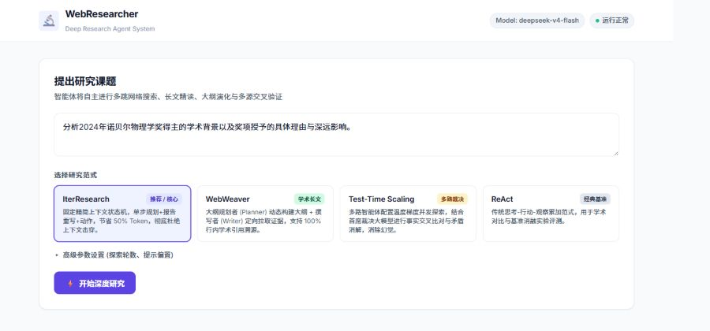

# WebResearcher (IterResearch)

A modular, async deep-research agent system. It calls search, page-reading, evidence-extraction, and Python
tools so an LLM can research a complex question over multiple rounds — with live progress in a web console.

**Live demo:** https://researcher.soulboy.xyz

## Research modes

- **IterResearch** — fixed-context iterative research; the default for most questions
- **WebWeaver** — planner drafts an outline, then a writer agent composes the long-form report
- **Test-Time Scaling** — runs multiple research branches in parallel, then a synthesizer adjudicates
- **ReAct** — classic think/act/observe loop, useful as a baseline

## Capabilities

- Search fallback chain: Tavily → Serper → Baidu
- Page fetching, content cleaning, evidence extraction, citation assembly
- FastAPI service with SSE real-time progress and a minimal web console
- OpenAI-compatible API — works with OpenAI, DeepSeek, vLLM, and similar endpoints

## Quickstart

Requires Python 3.11+.

```bash
python -m venv .venv && source .venv/bin/activate
pip install -r requirements.txt
cp .env.example .env
# edit .env: set LLM_API_KEY and any search-service keys
```

Serve the web UI:

```bash
python main.py serve --host 127.0.0.1 --port 8000
# open http://127.0.0.1:8000
```

Or run from the CLI:

```bash
python main.py run "Analyze the impact of AI on the EV industry" --mode iter --rounds 5
```

## API

| Method | Path | Purpose |
| ------ | ---- | ------- |
| GET | `/api/health` | health check |
| GET | `/api/research/modes` | list research modes |
| POST | `/api/research/start` | create a research task |
| GET | `/api/research/stream/{task_id}` | SSE live progress |
| GET | `/api/research/status/{task_id}` | task status + final report |
| POST | `/api/research/cancel/{task_id}` | cancel a task |

## Key design decisions

- **Fixed-context state machine.** Each round is a single LLM call that jointly emits Plan / Report / Action.
  The workspace retains only Question + rolling Report + last observation, so long research chains don't
  blow up the context window — new evidence is folded into the rolling report before the next round.
- **Dual-protocol structured output.** Accepts OpenAI function calling, XML / DSML `tool_call`, and JSON5
  payloads, with auto-repair for markdown fences, truncated JSON, and hoisted params — all normalized into
  one `ToolRegistry`.
- **Degradable everything.** Every external dependency has a fallback chain; per-error-type retry vs.
  fail-fast in the LLM client; research supports timeouts, max rounds, forced convergence, cancellation,
  and resume-from-breakpoint.

## Layout

```
agents/   agents for each research paradigm
core/     LLM client, prompts, context guards, protocol parsing
tools/    search, page reading, evidence extraction, memory, compute
schema/   message / tool-call / result data structures
server/   FastAPI endpoints, task manager, static pages
config/   env vars and runtime config
main.py   CLI + web entry
```

## Config

- `LLM_API_KEY`, `LLM_BASE_URL`, `LLM_MODEL_NAME` — primary model
- `SUMMARY_MODEL_NAME` — synthesis model for long reports
- `TAVILY_API_KEY`, `SERPER_API_KEY`, `JINA_API_KEY` — optional external services
- `MAX_INPUT_TOKENS`, `OBS_MAX_CHARS` — context and observation guards

Commit only `.env.example`, never `.env` or logs. The task manager currently keeps state in process
memory — add persistent task storage, auth, queues, and multi-instance coordination for production use.

---

## 中文文档

# WebResearcher

一个支持多种研究范式的异步深度研究 Agent 示例。系统可以调用搜索、网页访问、证据抽取和 Python 计算工具，让大模型围绕一个复杂问题进行多轮研究，并通过 Web 页面实时展示过程。



## 主要能力

- `IterResearch`：固定上下文的迭代研究模式，适合大多数问题；
- `WebWeaver`：先规划大纲，再由撰写 Agent 组织长篇报告；
- `Test-Time Scaling`：并行运行多个研究分支，再由合成器裁决；
- `ReAct`：经典的思考、行动、观察循环，适合做基线对比；
- Tavily → Serper → 百度的搜索降级链路；
- 网页访问、内容清洗、证据抽取和引用整理；
- FastAPI 服务、SSE 实时进度流和简单 Web 控制台；
- OpenAI 兼容接口，支持 OpenAI、DeepSeek、vLLM 等服务。

## 运行方式

需要 Python 3.11 或更高版本。

在项目目录执行：

```powershell
py -3.11 -m venv .venv
.\.venv\Scripts\Activate.ps1
python -m pip install -r requirements.txt
Copy-Item .env.example .env
# 编辑 .env，填写 LLM_API_KEY 和需要使用的搜索服务 Key
```

启动 Web 服务：

```powershell
python main.py serve --host 127.0.0.1 --port 8000
```

浏览器访问 <http://127.0.0.1:8000>。

直接使用命令行：

```powershell
python main.py run "分析人工智能对新能源汽车行业的影响" --mode iter --rounds 5
```

健康检查：<http://127.0.0.1:8000/api/health>

## API 流程

```text
创建研究任务
    ↓
TaskManager 保存任务并启动后台协程
    ↓
Agent 选择工具并多轮执行
    ↓
SSE 推送阶段、工具调用和中间结果
    ↓
任务完成后返回报告、耗时和 Token 使用量
```

核心接口：

| 方法 | 地址 | 作用 |
| --- | --- | --- |
| GET | `/api/health` | 健康检查 |
| GET | `/api/research/modes` | 查看研究模式 |
| POST | `/api/research/start` | 创建研究任务 |
| GET | `/api/research/stream/{task_id}` | SSE 实时进度 |
| GET | `/api/research/status/{task_id}` | 查看任务和最终报告 |
| POST | `/api/research/cancel/{task_id}` | 取消任务 |

## 目录说明

```text
agents/   不同研究范式的 Agent
core/     LLM 客户端、提示词、上下文保护和协议解析
tools/    搜索、网页访问、证据抽取、记忆和计算工具
schema/   消息、工具调用和结果数据结构
server/   FastAPI 接口、任务管理器和静态页面
config/   环境变量和运行配置
main.py   CLI 与 Web 服务入口
```

## 配置说明

- `LLM_API_KEY`、`LLM_BASE_URL`、`LLM_MODEL_NAME`：主要模型配置；
- `SUMMARY_MODEL_NAME`：长报告合成模型；
- `TAVILY_API_KEY`、`SERPER_API_KEY`、`JINA_API_KEY`：可选外部服务；
- `MAX_INPUT_TOKENS`、`OBS_MAX_CHARS`：上下文和观察结果保护；
- `DEFAULT_WORKSPACE`：运行时工作区，默认不应提交到 Git。

请只提交 `.env.example`，不要提交 `.env` 或日志。当前任务管理器和结果保存在进程内存中，服务重启后任务列表不会保留；如果要面向长期生产使用，需要增加持久化任务存储、身份认证、队列和多实例协调。
